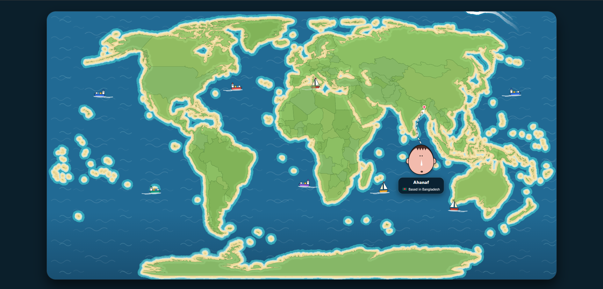

<!-- ═══════════════════════════════════════════════════════════════ -->
<!--                    AHANAF'S PORTFOLIO                        -->
<!-- ═══════════════════════════════════════════════════════════════ -->

#  AHANAF MOKAMMEL OMI 

### Full-Stack Developer · Software Engineer · AI Builder

*Crafting digital experiences with passion and precision.*

Building scalable web applications, distributed systems, and AI-powered solutions that make a difference.

 

 

**A personal portfolio built around motion, illustration, and exploration.**

---

## 01 / THE EXPERIENCE

This portfolio is an interactive, illustrated journey through my work, education, technical skills, and professional experience.

Rather than presenting everything in a conventional grid of cards, the experience combines a custom illustrated environment, a persistent character, animated typography, interactive project objects, and a continuous scrolling layout.

The visual direction is playful, expressive, and intentionally different from a traditional developer portfolio.

### ✦ Design philosophy

- **Immersive storytelling** — Discover each section through a continuous scrolling experience.
- **Illustrated identity** — A custom character and textured purple environment create a recognizable visual identity.
- **Interaction with purpose** — Project objects, technology icons, and social links invite exploration.
- **Motion and atmosphere** — Animated reveals, transitions, and a persistent progress indicator provide visual continuity.
- **Responsive by design** — Adaptations for desktop, tablet, and mobile screens.
- **Accessibility considerations** — Reduced-motion preferences are supported for key scroll animations.

---

## 02 / INSIDE THE PORTFOLIO

| EXPERIENCE | DESCRIPTION |
|:---:|---|
| ✦ Hero | Animated introduction and personal statement |
| 🎓 Education | Academic background and qualifications |
| 🧩 Skills | Interactive technology icons and animated indicators |
| 💿 Projects | Interactive project disks with detailed descriptions |
| 💼 Experience | Professional and extracurricular experience |
| 📄 Documents | Shortcuts for CV, certificates, and thesis |
| 🔗 Connections | LinkedIn, GitHub, email, and Discord |
| 🌍 World Map | Interactive geographic visualization with a Bangladesh location marker |

### The character

The portfolio features a persistent character stage, using image and canvas layers to support the illustrated visual experience as visitors scroll through the page.

### The project universe

Projects are presented as interactive disks rather than a conventional card grid. Selecting a project opens a browser-inspired window with a project description, technology stack, and relevant links.

### The world map

The map uses D3.js and TopoJSON to render geographic data, with a distinctive illustrated appearance. Country boundaries, hover interactions, and the location marker make it part of the portfolio's identity.

---

## 03 / TECHNOLOGY STACK

### Frontend

### Backend & Data

### Visualization & Infrastructure

### Implementation details

| Technology | Role |
|---|---|
| HTML5 | Portfolio structure and semantic markup |
| CSS3 | Illustrated environment, responsive styling, transitions, and keyframe animations |
| JavaScript | Scroll interactions, project modals, skill interactions, and dynamic interface behavior |
| D3.js | Geographic rendering and map interactions |
| TopoJSON | Geographic boundary data |
| Google Fonts | Chewy and Mansalva typography |
| Canvas | Character rendering layers and visual fallback support |
| Vercel | Portfolio deployment and analytics integration |

---

## 04 / FEATURED PROJECTS

A collection of software engineering, AI, infrastructure, enterprise, and web application projects.

### ◈ ENTERPRISE SYSTEMS & INTELLIGENCE

### 01. NEXUS — Supply Chain Intelligence

A supply-chain decision-support platform that models dependencies, identifies bottlenecks, and simulates disruptions.

- Graph-based dependency analysis using BFS and DFS.
- Stockout, service-level, and revenue-at-risk simulations.
- Role-based access control, audit logging, and real-time updates.

**Stack:** ASP.NET Core MVC · C# · PostgreSQL · Redis · EF Core · Docker

[↗ View Repository](https://github.com/BigSmoke4/NEXUS-Supply-Chain-Intelligence-Command-Center)

### 02. VERITAS — Identity & Access Governance

A zero-trust identity and access management platform focused on policy evaluation, risk-aware authentication, and privileged access.

- RBAC and ABAC authorization.
- Risk-aware multifactor authentication and just-in-time access.
- Policy versioning, access reviews, and secure API-key management.

**Stack:** ASP.NET Core · C# · PostgreSQL · Redis · EF Core · Identity

[↗ View Repository](https://github.com/BigSmoke4/VERITAS)

### 03. NEURA — AI Agent Orchestration

A multi-agent platform designed to maintain task continuity across different AI providers.

- Validated context handoffs and weighted provider routing.
- Memory, knowledge graphs, and AI provider adapters.
- Retry strategies, circuit breakers, rate limiting, and cost tracking.

**Stack:** ASP.NET Core · C# · PostgreSQL · Redis · SignalR · AI APIs

[↗ View Repository](https://github.com/BigSmoke4/NEURA-Neural-AI-Agent-Orchestration-Continuity-Platform)

### 04. FORGE — Software Engineering Intelligence

An engineering intelligence platform that analyzes repositories, code structure, dependencies, and technical risk.

- Roslyn-based C# semantic analysis and symbol extraction.
- Repository indexing and dependency graph construction.
- Security-pattern detection, technical-debt analysis, and architecture policies.

**Stack:** ASP.NET Core · C# · Roslyn · PostgreSQL · EF Core · Git

[↗ View Repository](https://github.com/BigSmoke4/FORGE-AI-Software-Engineering-Intelligence-Platform)

### 05. PULSE — Distributed Job Processing

A job orchestration and workflow platform built around reliable background processing.

- RabbitMQ priority queues and dead-letter handling.
- Redis locks, idempotency, retries, and worker heartbeats.
- Job scheduling, cancellation, and queue monitoring.

**Stack:** ASP.NET Core MVC · C# · RabbitMQ · Redis · SQL Server · EF Core

[↗ View Repository](https://github.com/BigSmoke4/Pulse-Job-Orchestrator)

### ◈ WEB PLATFORMS & AUTONOMOUS SYSTEMS

### 06. BDPriceFinder — Multi-Vendor Price Comparison

A Bangladesh-focused e-commerce and price-comparison platform with vendor workflows and role-specific dashboards.

- Product lifecycle management, inventory, and order workflows.
- Dynamic product variants, coupons, EMI, and warranty support.
- Email OTP authentication, Elasticsearch search, and Redis caching.

**Stack:** ASP.NET MVC · C# · Razor Views · JavaScript · SQL Server

[↗ Visit Website](https://bdpricefinder.com/)

### 07. LOCAL AGENT — Autonomous Coding Platform

A local-first autonomous coding platform designed to plan, execute, and verify multi-step engineering tasks.

- Persistent sessions and dependency-aware DAG task planning.
- Incremental repository indexing and cross-file reference graphs.
- Layered memory, retrieval, retries, and verification loops.

**Stack:** ASP.NET Core · C# · PostgreSQL · EF Core · Ollama · Roslyn · SignalR

[↗ View Repository](https://github.com/BigSmoke4/Local-Agent-Platform)

### 08. ATLAS — Intelligent API & Event Platform

An enterprise platform for API management, event processing, traffic control, and operational observability.

- Kafka-based event processing and replayable dead-letter queues.
- Redis-backed rate limiting and circuit breakers.
- Tenant authorization, health probing, and service-level monitoring.

**Stack:** ASP.NET Core · C# · PostgreSQL · Redis · Kafka · OpenTelemetry

[↗ View Repository](https://github.com/BigSmoke4/ATLAS-Enterprise-Intelligent-API-Event-Platform)

### 09. AURORA — Organizational Resilience

A decision-intelligence and digital-twin platform for modeling organizational dependencies and evaluating disruptions.

- Graph traversal and shortest-path analysis.
- Bottleneck detection and disruption propagation.
- Risk scoring, investigation workflows, and audit trails.

**Stack:** ASP.NET Core MVC · C# · PostgreSQL · EF Core · SignalR

[↗ View Repository](https://github.com/BigSmoke4/AURORA-Autonomous-Unified-Reasoning-Organizational-Resilience-Architecture)

### 10. SENTINEL — Operational Risk Simulator

An operational-risk simulation platform designed to model failures and measure resilience.

- Dependency graphs and critical-path analysis.
- Monte Carlo simulation using normal and log-normal distributions.
- Recovery-strategy scoring, resilience metrics, and risk heatmaps.

**Stack:** ASP.NET Core MVC · C# · PostgreSQL · Redis

[↗ View Repository](https://github.com/BigSmoke4/sentinel-risk-simulator)

### 11. AEGIS — Intelligent Incident Response

An incident-response and digital-operations platform focused on anomaly detection, correlation, and root-cause analysis.

- Rolling z-score anomaly detection.
- Graph-based incident correlation and root-cause ranking.
- Business-impact analysis and human-approved remediation runbooks.

**Stack:** ASP.NET Core MVC · C# · PostgreSQL · Redis

[↗ View Repository](https://github.com/BigSmoke4/Aegis-Intelligent-Incident-Response-Digital-Operations-Platform)

### 12. NIRBHOR — Bilingual AI Assistant

A bilingual administrative AI agent supporting English, Bangla, and mixed-language interactions.

- Conversational workflows for administrative tasks.
- Versioned prompts and multilingual evaluation datasets.
- Audit logging, notifications, cost tracking, and observability.

**Stack:** ASP.NET Core MVC · C# · PostgreSQL · EF Core · Identity · SignalR · AI APIs

[↗ View Repository](https://github.com/BigSmoke4/NIRBHOR-Bilingual-AI-Personal-Administrative-Agent)

### 13. E-Commerce — ASP.NET MVC Application

A responsive, database-driven e-commerce application built with a structured MVC architecture.

- Product management and shopping-cart functionality.
- Separated controllers, models, services, and views.
- Database integration through Entity Framework and SQL Server.

**Stack:** ASP.NET MVC · C# · Razor Views · Entity Framework · SQL Server

[↗ View Repository](https://github.com/BigSmoke4/Responsive-Ecommerce-asp.net-MVC-razor-view)

---

## 05 / SKILLS & TECHNOLOGIES

**Languages**

**Backend & Data**

**Engineering & AI**

---

## 06 / PROFESSIONAL JOURNEY

### Full-Stack Developer

**Billing Master Software Limited (BMSL)** · Bangladesh

`2025 — Present`

- Developed 3+ ASP.NET MVC modules, improving internal processing efficiency by 30%.
- Implemented CRUD and database features that reduced user-reported errors by 25%.
- Optimized SQL queries, resulting in 20% faster data retrieval.

### Executive Member

**BRAC University Computer Club**

`2022 — 2025`

- Organized coding workshops and hackathons involving more than 100 students.
- Collaborated with the web team on the club website and event registration systems.

### General Member

**Dhaka Residential Model College Computer Club**

`2018 — 2020`

- Participated in school-level computing and technology activities.

---

## 07 / EDUCATION

| Qualification | Institution | Year |
|---|---|---|
| B.Sc. in Computer Science | BRAC University, Bangladesh | 2026 |
| Higher Secondary Certificate | Dhaka Residential Model College | 2020 |
| Secondary School Certificate | Ibn Taimiya School and College | 2018 |

---

## 08 / BEYOND THE CODE

The portfolio is also a creative experiment in how software can feel.

Its visual identity combines:

- **Chewy & Mansalva** typography for a hand-drawn character.
- **Textured purple backgrounds** and illustrated environmental details.
- **Animated entrances** with staggered reveals, sliding transitions, and playful effects.
- **Interactive project disks** that open detailed, browser-inspired project windows.
- **A custom geographic visualization** built with D3.js and TopoJSON.
- **Responsive layouts** and reduced-motion support for a more adaptable experience.

The goal is simple: build software that is functional, thoughtfully engineered, and memorable to explore.

---

## 09 / CONNECT

### Let's build something meaningful.

I'm interested in full-stack engineering, backend architecture, distributed systems, developer tools, and applied AI.

 

---

<!-- ═══════════════════════════════════════════════════════════════ -->
<!--                   THE FINAL DESTINATION                       -->
<!-- ═══════════════════════════════════════════════════════════════ -->

 

### 🌍 A SMALL POINT ON A BIG WORLD

*Every journey starts somewhere.*

 

 

### 📍 Based in Bangladesh

*Building for the world, from Bangladesh.*

 

Designed & developed by Ahanaf Mokammel Omi · © 2026

  

<!-- ═══════════════════════════════════════════════════════════════ -->
<!--                          END                                   -->
<!-- ═══════════════════════════════════════════════════════════════ -->
